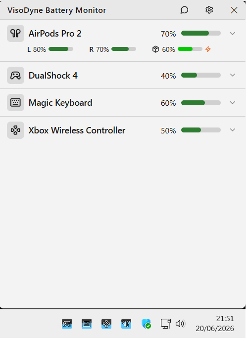
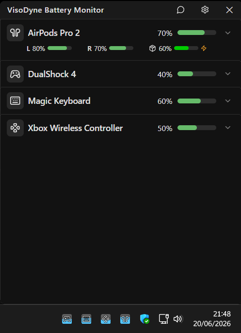
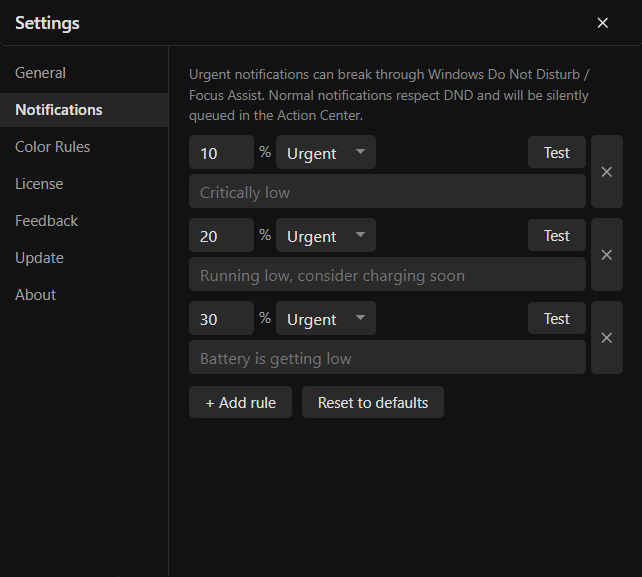
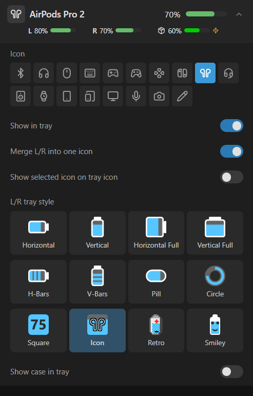
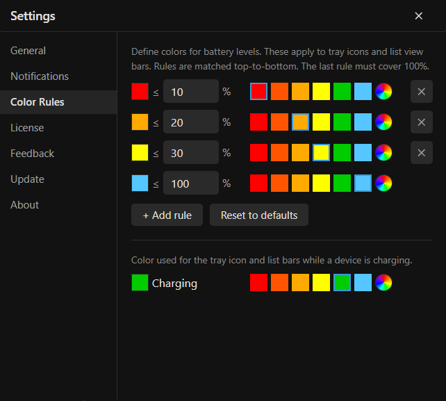
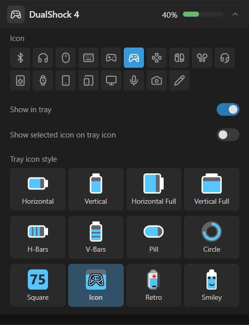
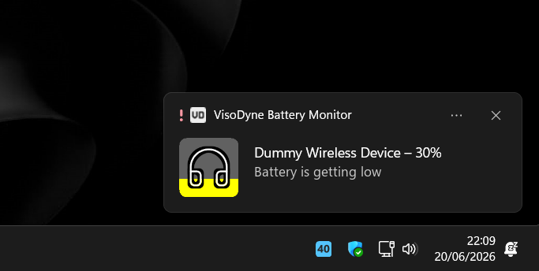

# VisoDyne Battery Monitor for Windows 11 & Windows 10

**Check Bluetooth and 2.4 GHz wireless device battery levels from your Windows system tray.** VisoDyne Battery Monitor tracks supported AirPods, earbuds, headphones, gaming headsets, wireless mice, keyboards, and game controllers, with low-battery alerts so you know when to recharge.

[Get it from the Microsoft Store](https://apps.microsoft.com/detail/xpfpjch810mwl0) | [Download classic Windows setup](https://download.visodyne.com/v1/batterymonitor/setup) | [Supported devices](https://visodyne.com/en/battery-monitor/supported-devices) | [Official product page](https://visodyne.com/en/battery-monitor)

<p align="center">
  
  
</p>

## Download VisoDyne Battery Monitor for Windows

Choose either installation option for Windows 10 or Windows 11:

- **[Microsoft Store](https://apps.microsoft.com/detail/xpfpjch810mwl0)** - install VisoDyne Battery Monitor from its Windows Store listing.
- **[Classic setup installer](https://download.visodyne.com/v1/batterymonitor/setup)** - download the Windows installer directly from VisoDyne.

Both versions include the **free Community edition** and a **free trial of Pro features**. The same VisoDyne Pro license key works with both versions.

## Wireless Battery Monitoring Features

- **Battery percentage in the Windows system tray:** see the charge of supported Bluetooth, 2.4 GHz, and proprietary wireless devices without opening a vendor utility.
- **AirPods battery on Windows:** view separate left earbud, right earbud, and charging case levels when reported by the device.
- **Wireless headset, mouse, keyboard, and controller monitoring:** keep battery information together in one app.
- **Low-battery notifications:** get default alerts in Community, or customize normal and urgent warnings with Pro.
- **Customizable tray icons:** choose device visibility, with additional icon styles and battery-color thresholds in Pro.
- **Estimated battery time:** get remaining-time estimates for devices that report charge in coarse steps.
- **Background operation:** keep monitoring from the tray, with optional launch at Windows startup.

Feature availability depends on the edition and the battery information supplied by each device. See [Community vs. Pro](#free-community-edition-and-pro) below.

## Supported Bluetooth and Wireless Devices

The models below are **supported examples, not a complete compatibility list**, drawn from the [official supported-device catalog](https://visodyne.com/en/battery-monitor/supported-devices). Compatibility varies by model, firmware, receiver, and connection type. A supported connection must expose battery data; not every device provides an exact percentage or separate earbud and case readings.

### AirPods, Beats, Bluetooth Headphones, and Earbuds

| Brand | Supported examples |
| --- | --- |
| Apple AirPods | AirPods 1, 2, 3, 4, AirPods 4 ANC, AirPods Pro, AirPods Pro 2, AirPods Pro 3, AirPods Max, AirPods Max (USB-C) |
| Beats | Studio Buds, Studio Buds+, Fit Pro, Solo Buds, Flex, Powerbeats Pro, Powerbeats Pro 2, Solo 3, Solo 4, Studio Pro |
| Sony | WH-1000XM2, WH-1000XM3, WH-1000XM4, WH-1000XM5, WH-1000XM6, WF-1000XM3, WF-1000XM4, WF-1000XM5, LinkBuds S |
| Nothing and CMF | Nothing Ear (1), Ear (2), Ear (3), Ear (a), Ear (stick), Ear (open), CMF Buds, CMF Buds 2 Plus |
| Soundcore | Liberty 3 Pro, Liberty 4 NC, Sport X20, A30i, AeroFit 2, Q30 / Life Q30, Life Tune, Life Tune XR |
| Other Bluetooth audio | Apollo Q10, QCY H3, Soundcore Motion 300 speaker |

### Wireless Gaming Headsets

| Brand | Supported examples |
| --- | --- |
| SteelSeries | Arctis Nova 7, Nova 7 Gen 2, Nova 7X, Nova 7P, Nova 5, Nova 5X, Nova Pro Wireless, Arctis 7, 7+, 7P+, 7X+, Arctis 1 Wireless, Arctis 9, Arctis Pro Wireless, Arctis GameBuds |
| Logitech | G533, G535, G633, G635, G733, G933, G935, G PRO X Wireless, G PRO X 2 LIGHTSPEED, G522 LIGHTSPEED |
| HyperX | Cloud Flight, Cloud Flight S, Cloud Alpha Wireless, Cloud II Wireless, Cloud II Core Wireless, Cloud III Wireless, Cloud Stinger 2 Wireless |
| Corsair | Virtuoso RGB Wireless SE, Virtuoso XT Wireless, Virtuoso Max Wireless, Void Wireless, Void Pro Wireless, Void Elite Wireless, Void v2 Wireless, HS80 Max Wireless |
| Razer | Barracuda Pro (newer receiver), BlackShark V2 Pro (2020), BlackShark V3 |
| Other gaming headsets | Audeze Maxwell, ASUS ROG Delta S Wireless, ASUS ROG Strix Go 2.4, Astro A50 Wireless Gen 4, Astro A50 Gen 5, JBL Quantum 910, Sony INZONE H5, Sony INZONE H9 II |

### Wireless Mice and Keyboards

| Brand or device family | Supported examples |
| --- | --- |
| Logitech | G PRO X SUPERLIGHT, G502 LIGHTSPEED, MX Mechanical, and supported mice and keyboards using Unifying, LIGHTSPEED, or Bolt receivers |
| Razer mice | Basilisk Ultimate, Basilisk V3 Pro, Basilisk X HyperSpeed, DeathAdder V2 Pro, DeathAdder V3 Pro, DeathAdder V4 Pro, Viper Ultimate, Viper V2 Pro, Viper V3 Pro, Orochi V2, Naga Pro, Naga V2 Pro, Cobra Pro |
| Razer keyboards | BlackWidow V3 Pro, BlackWidow V3 Mini HyperSpeed, BlackWidow V4 Mini HyperSpeed, DeathStalker V2 Pro, DeathStalker V2 Pro TKL, Pro Type Ultra |
| SteelSeries mice | Aerox 3 Wireless, Aerox 5 Wireless, Aerox 9 Wireless, Rival 3 Wireless, Rival 3 Wireless Gen 2 |
| Corsair | Dark Core RGB Pro, Dark Core RGB Pro SE, Ironclaw RGB Wireless, Harpoon RGB Wireless, K65 PLUS Wireless, K57 RGB Wireless |
| AULA keyboards | F75, F75 Max, F87 Pro, F87 Pro V2C, F99 Pro |
| Other wireless mice | VXE R1, VXE R1 Pro Max, ATK X1 Ultimate, Pulsar X2 V2 Mini, Pulsar X2 V3 Mini, Finalmouse UltralightX, LAMZU Maya X, WLmouse Beast X, Attack Shark X11 |
| Other wireless keyboards | Womier L65, Lofree Flow Lite84, AJAZZ AK820 Max Ultra, Rapoo V700DIY-98 |

### Wireless Game Controllers

- **PlayStation:** DualSense, DualSense Edge, DualShock 4, and Access Controller.
- **Xbox:** Xbox Wireless Controller.
- **Nintendo:** Switch Pro Controller, Joy-Con, and Switch Online SNES, N64, and SEGA Genesis controllers.
- **Valve:** Steam Controller and Steam Deck.
- **Other controllers:** FlyDigi Vader 5 Pro, HORI Wireless Switch Pad, PDP Afterglow Wireless Switch Controller, PDP REALMz Wireless Controller, and compatible PS4 controllers.

Other Bluetooth devices may also work when they report battery information through a supported protocol. The free Community edition works with every supported device, so you can install it and see your device's battery right away. Visit the [full supported-device list](https://visodyne.com/en/battery-monitor/supported-devices) for more models and receiver-specific notes.

## How to Install

### Microsoft Store

1. Open the [VisoDyne Battery Monitor Microsoft Store listing](https://apps.microsoft.com/detail/xpfpjch810mwl0).
2. Install the app, then launch **VisoDyne Battery Monitor** from the Start menu.
3. Connect your wireless devices and check their battery levels in the app.

### Classic Windows Setup

1. [Download the classic setup installer](https://download.visodyne.com/v1/batterymonitor/setup).
2. Run the installer and approve the administrator prompt.
3. Launch **VisoDyne Battery Monitor** from the Start menu or desktop shortcut.
4. Connect your wireless devices and choose which device to show in the system tray.

### WinGet

You can also install from Windows Terminal or PowerShell:

```powershell
winget install --id VisoDyne.BatteryMonitor
```

## Free Community Edition and Pro

The **Community edition is free and never expires**: no account and no time limit. It detects and shows every supported device in the app window, with one device in the system tray and default low-battery alerts. You can switch the tray icon to another device at any time.

**Pro** adds tray icons for unlimited devices, custom icon styles, custom battery colors, custom notification rules, and faster refresh intervals. Pro is a **one-time purchase, not a subscription**. A free trial lets you try the paid features before buying.

See the [official product page for current Pro features and licensing](https://visodyne.com/en/battery-monitor).

## Screenshots

| Device overview | Notifications |
| --- | --- |
|  |  |

| AirPods detail | Color rules |
| --- | --- |
|  |  |

| Device settings | Battery warning |
| --- | --- |
|  |  |

## Updates

The classic setup version includes built-in update checks. Downloaded updates are verified against a SHA-256 checksum before installation, and interrupted updates retain rollback data.

## Frequently Asked Questions

### How do I check AirPods battery levels on Windows?

Install VisoDyne Battery Monitor, connect your AirPods via Bluetooth, and open the app. Supported AirPods report separate left earbud, right earbud, and case battery levels. Readings depend on what the device is currently reporting.

### Can I see my wireless mouse, headset, or controller battery in the taskbar?

Yes, supported devices can show their battery level in the Windows system tray, also called the taskbar notification area. Community shows one device there; Pro adds a tray icon for each device.

### Does it work with 2.4 GHz USB receivers as well as Bluetooth?

Yes. The app supports Bluetooth battery reporting and supported 2.4 GHz or proprietary wireless receivers. Compatibility depends on the device and receiver, not just the brand. See the [supported-device catalog](https://visodyne.com/en/battery-monitor/supported-devices) for receiver-specific notes.

### What if my device is not listed or its battery is missing?

The list is not exhaustive, and device support is continually updated. You can help in two ways:

- Enable **Share usage data to help improve the app** in **Settings > About**. These periodic device and battery diagnostics help us find devices the app detects but cannot read reliably yet.
- Use the **Feedback** button in the app's title bar and choose the **Device Support** category to report a missing or misreported device, including its model and connection type.

## Official Links

- [VisoDyne Battery Monitor product page](https://visodyne.com/en/battery-monitor)
- [Supported Bluetooth and wireless devices](https://visodyne.com/en/battery-monitor/supported-devices)
- [Microsoft Store download](https://apps.microsoft.com/detail/xpfpjch810mwl0)
- [Classic Windows setup download](https://download.visodyne.com/v1/batterymonitor/setup)